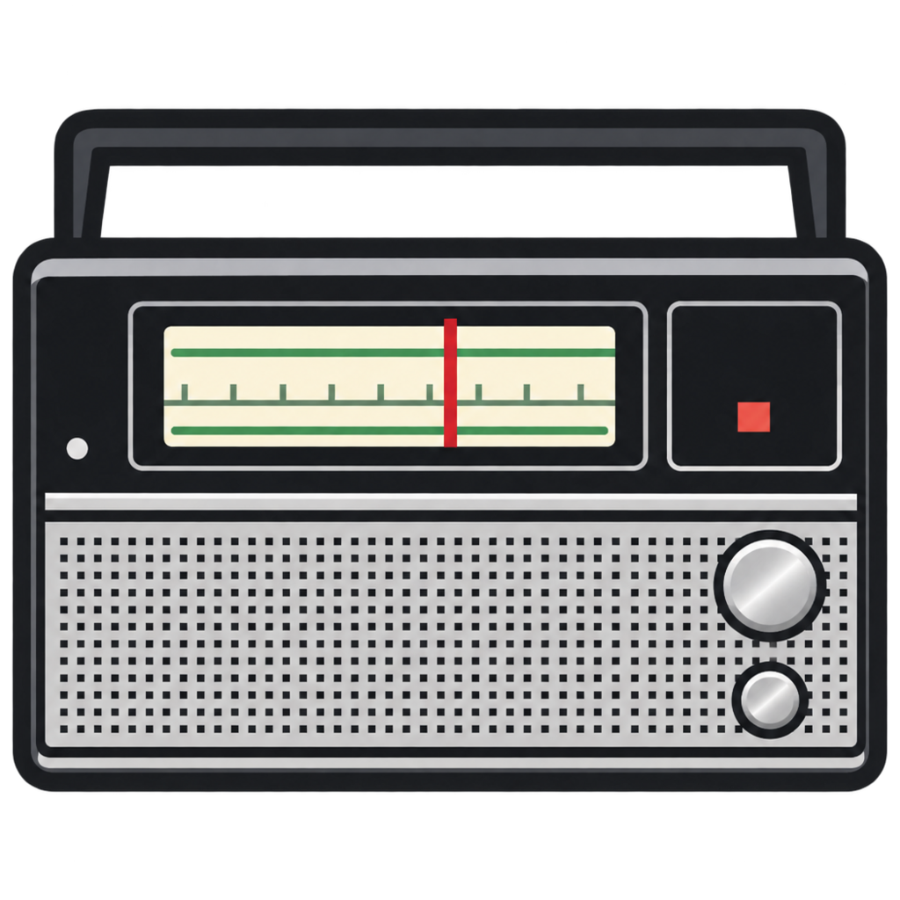

<div align="center">
<a href="https://github.com/nerdyslacker/priyomnik"></a>
</div>
<h1 align="center">priyomnik</h1>
<div align="center">

[](https://github.com/nerdyslacker/priyomnik/blob/main/LICENSE)
[](https://github.com/nerdyslacker/priyomnik/releases)
<a href="https://app.commanddash.io/agent?github=https://github.com/nerdyslacker/priyomnik"></a>
[](https://github.com/nerdyslacker/priyomnik/stargazers)
[](https://github.com/nerdyslacker/priyomnik/fork)

</div>

Priyomnik is a small tray-only internet radio player for Linux. It keeps one
headless mpv process for playback, exposes playback and volume commands through
a local Unix socket, and uses a StatusNotifierItem tray icon with a DBusMenu.
There is no main window and no GUI toolkit linked into Priyomnik; the optional
station editor uses the external `yad` dialog program.

## Features

- Tray menu with stations, optional flat groups, stop, volume, mute, reload,
  and quit.
- Optional graphical station editor for adding, editing, and removing stations.
- MPRIS v2 interface for desktop media keys and clients such as `playerctl`.
- Stopped, connecting, playing, and error icons.
- Station and artist/title metadata in the menu and tooltip.
- Optional freedesktop notifications with duplicate suppression.
- Regular CLI control of the running instance.
- Single instance with a secure Unix control socket.
- Atomic JSON configuration writes and bounded mpv reconnect retries.
- Static CGO-free build.

## Requirements

Runtime:

- Linux with a StatusNotifierItem and DBusMenu host, such as KDE Plasma.
- A D-Bus session bus.
- `mpv` in `PATH`, with JSON IPC support.
- Optional: `yad` in `PATH` for the tray menu's station editor.
- Optional: a notification daemon implementing
  `org.freedesktop.Notifications`.

Build:

- Go 1.27.3 or newer.

Tested with mpv 0.41.0 on Void Linux and KDE Plasma. Input handling varies by
tray host; essential controls are always available in the menu and CLI.

## Build and install

```sh
make
sudo make install
```

The default prefix is `/usr/local`. To install elsewhere:

```sh
make install PREFIX="$HOME/.local"
```

To stage a package installation:

```sh
make install DESTDIR="/tmp/priyomnik-root" PREFIX=/usr
```

Remove an installation with the matching prefix and `DESTDIR`:

```sh
sudo make uninstall
```

`make install` places the binary in `$(PREFIX)/bin`, the desktop entry in
`$(PREFIX)/share/applications`, and the application icon in
`$(PREFIX)/share/icons/hicolor/256x256/apps`.

## Configuration

The configuration file is:

```text
${XDG_CONFIG_HOME:-$HOME/.config}/priyomnik/config.json
```

On first launch Priyomnik writes a default configuration. To start from the
example instead:

```sh
mkdir -p "${XDG_CONFIG_HOME:-$HOME/.config}/priyomnik"
cp config.example.json "${XDG_CONFIG_HOME:-$HOME/.config}/priyomnik/config.json"
```

[`config.example.json`](config.example.json) contains:

| Field | Meaning |
| --- | --- |
| `volume` | Startup volume, 0-100. |
| `volume_step` | Amount added or removed by volume commands; positive. |
| `autoplay` | Play `last_station` when the tray starts. |
| `notifications` | Enable desktop notifications. |
| `last_station` | Station ID to play by default and after restart. |
| `stations` | Ordered station list. |

Each station has a unique `id`, a display `name`, an absolute HTTP or HTTPS
`url`, and an optional `group`. Station and group order are preserved. Reload
the file from the tray or with `priyomnik reload`; invalid configuration is
rejected without replacing the active settings.

The tray menu's **Edit stations...** item opens a `yad` dialog for adding,
editing, and removing stations. Leaving a new station's ID blank generates one
from its name. Changes are validated and written atomically; the menu updates
immediately. If `yad` is not installed, edit the JSON file and use **Reload
stations** instead.

## CLI

```text
priyomnik                 Start tray, or use the running instance
priyomnik play [STATION]  Play last or named station
priyomnik stop            Stop playback
priyomnik toggle          Toggle playback
priyomnik next            Play next station
priyomnik prev            Play previous station
priyomnik volume [+-]N    Adjust volume
priyomnik mute            Toggle mute
priyomnik status [--json] Show status
priyomnik reload          Reload configuration
priyomnik quit            Quit the running instance
priyomnik help            Show help
```

`priyomnik status` prints a compact line such as `playing radio-paradise 70`.
Use `priyomnik status --json` for machine-readable output.

## Tray behavior

- Left click opens the menu.
- Right click opens the menu.
- Middle click toggles playback.
- Scroll adjusts volume by `volume_step`.

Middle click and scroll use the StatusNotifierItem `SecondaryActivate` and
`Scroll` events. Host support varies. Station selection, volume, mute, reload,
station editing, and quit remain available from the menu and CLI.

## MPRIS and media keys

Priyomnik registers `org.mpris.MediaPlayer2.priyomnik` on the session bus. Desktop
media keys and MPRIS clients control the running instance:

```sh
playerctl -p priyomnik play-pause
playerctl -p priyomnik stop
playerctl -p priyomnik next
playerctl -p priyomnik previous
playerctl -p priyomnik volume 0.5
```

Play, pause, stop, next/previous, and volume are supported. Seeking and
`OpenUri` are not supported because live streams are not seekable. MPRIS is
disabled silently when the session bus is unavailable or the name is already
owned.

## Release builds and dependencies

Dependencies are pinned in `go.mod` and `go.sum`. Builds use `-mod=readonly` so
the module graph is not changed implicitly.

```sh
go mod verify
CGO_ENABLED=0 go build -mod=readonly -trimpath -ldflags="-s -w" -o priyomnik .
```

The resulting binary is statically linked and stripped. Run `make vet` and
`make fmt` before release.

## Void Linux package

A xbps-src template is provided at
[`packaging/void/template`](packaging/void/template). It builds with the
project Makefile, installs under `/usr`, depends on `mpv` and `yad`, and
installs the license.

After tagging a release as `v0.1.0`, compute the archive checksum and replace
`REPLACE_AFTER_TAGGING_V0.1.0` in the template:

```sh
curl -L -o priyomnik-0.1.0.tar.gz \
  https://github.com/nerdyslacker/priyomnik/archive/v0.1.0.tar.gz
sha256sum priyomnik-0.1.0.tar.gz
```

Then copy the template into a void-packages checkout and build:

```sh
cp packaging/void/template void-packages/srcpkgs/priyomnik/template
cd void-packages
xbps-src pkg priyomnik
```

## License

MIT. See [LICENSE](LICENSE).
